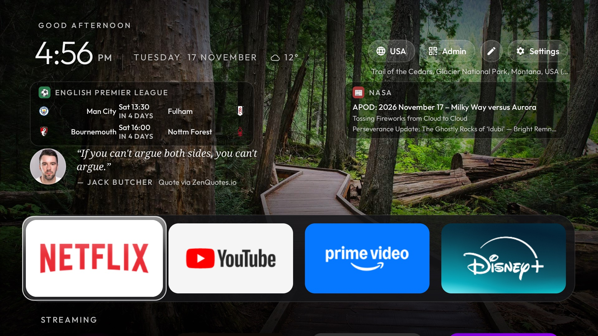
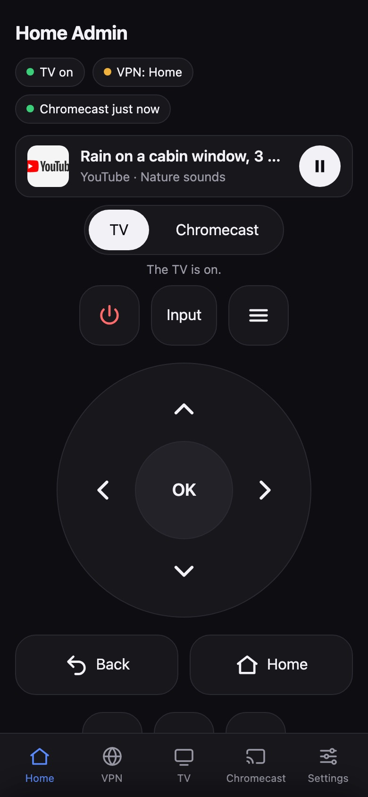
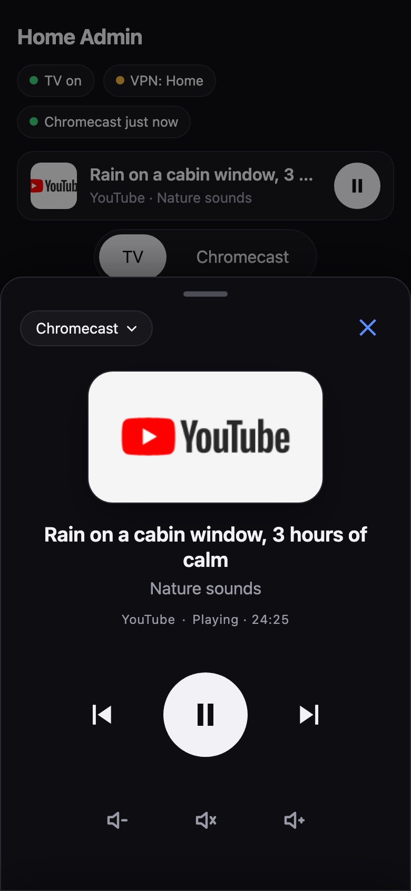
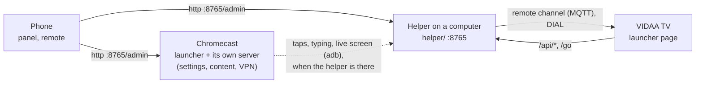

# Clean Your TV

A calm, ad-free Home screen for the **Chromecast with Google TV** and **Hisense VIDAA** TVs. Your apps, a clock, the
weather, live football scores, a daily photo, and nothing you didn't ask for. Change any of it from your phone, or
with the TV remote.

## Pick your setup

| You have | You need | Guide |
|---|---|---|
| **A Chromecast with Google TV** only | The app ([download](https://github.com/WahdanZ/cleanyourtv/releases/latest)); adb once, to install it | [Chromecast only →](docs/chromecast-only.md) |
| **A Chromecast and a Hisense VIDAA TV** | The app + the helper on an always-on computer | [Chromecast + VIDAA →](docs/chromecast-vidaa.md) |
| **A Hisense VIDAA TV** only | The helper on an always-on computer | [VIDAA only →](docs/vidaa-only.md) |

  
  

**Tested on** a Chromecast with Google TV 4K (Android 14) and Hisense VIDAA U9 TVs (a 50A5FE, firmware
V0000.09.09A.P0930; a 55U8Q, V0000.09.60I), October–November 2026. Other VIDAA TVs should behave alike; please
report yours.

## What it does

**Home, on the Chromecast and the TV**
- Your apps in a dock and titled rows; no ads or "recommended" rows.
- Above them, the blocks you choose: the clock (six styles), the weather, a quote of the day, widget cards (football,
  prayer times, news), what's playing with ⏮ ⏯ ⏭, and the app's name.
- A new photo every day: Bing's, Wikipedia's or NASA's picture of the day, or your own.
- Presets (Classic, Dashboard, Calm, Photo frame…), or move and resize every block. Edit Home with the remote too.

**Your phone: the panel and the remote** (a web page; add it to your Home screen)
- A remote for both devices, every app to open, a trackpad for the Chromecast, and the player with a sleep timer.
- A live picture of each Home to change: tap a block, drag apps, undo, save. It shows on the screen in seconds.
- Scenes ("Movie night": wake, VPN, Netflix), websites as apps, phone shortcuts for the lock screen, and Usage
  (how long the TV and the Chromecast were on, per app).

  
  
  

**The Chromecast** runs a native launcher that can run on its own, with no computer: its own server, phone panel and
VPN ([chromecast-only.md](docs/chromecast-only.md)).

**The VIDAA TV** gets its Home, native apps, a browser with search, Stremio, YouTube without ads and free live TV,
through the helper on a computer: VIDAA can't run apps of its own ([vidaa.md](docs/vidaa.md)).

**A VPN for the TV and the Chromecast only** (optional): watch another country's catalogue while the rest of your home
stays on your normal connection; an app can have its own country (OSN+ → UAE) ([vpn.md](docs/setup/vpn.md)).

## Guides

| Guide | For |
|---|---|
| [Chromecast only](docs/chromecast-only.md) · [Chromecast + VIDAA](docs/chromecast-vidaa.md) · [VIDAA only](docs/vidaa-only.md) | Getting started, per setup |
| [The VIDAA TV](docs/vidaa.md) | Everything about the TV: how it works, its set-up steps, Browser, Stremio, YouTube, Live TV, troubleshooting |
| [Clean your Chromecast](docs/chromecast-clean.md) | Turn off Google's ads, suggestions, screensaver and tracking (all reversible) |
| [The helper](docs/setup/helper.md) · [The Chromecast](docs/setup/chromecast.md) · [The VPN](docs/setup/vpn.md) | Each part in detail |
| [Make Home yours](docs/customize.md) · [Add-ons](addons/README.md) | Using the panel; writing your own widget |
| [Open problems](docs/OPEN-PROBLEMS.md) · [Challenges](docs/CHALLENGES.md) · [Findings](docs/FINDINGS.md) | What's not solved, and why things are the way they are |

## How it works

Two back ends answer the same requests, so the same phone panel works with either: **the Chromecast's own server**
(in the app) and **the helper** (Python, on a computer; needed for a VIDAA TV). Each keeps its settings, runs the
add-ons and fetches the photo and the weather; the screens check every few seconds for changes. Their shared parts
are in `shared/` and their common API in [shared/API.md](shared/API.md).

## Limits

- **VIDAA:** its remote's Home button still opens VIDAA's own home (ours comes back when the TV is turned on or
  Netflix, YouTube or Prime Video closes); the helper's computer must stay on.
- **Chromecast without a computer:** taps and typing inside other apps from the phone, and the live screen, need adb
  (the helper); installing the app needs adb once.
- **The Mac VPN:** with it, the TV (and a Chromecast using it) have no internet when the Mac is off.
- More in [docs/OPEN-PROBLEMS.md](docs/OPEN-PROBLEMS.md).

## Contributing

Read [docs/GUIDELINES.md](docs/GUIDELINES.md) first. The most useful contributions are tests on other VIDAA models
and Google TV devices, and progress on the [open problems](docs/OPEN-PROBLEMS.md). Please never post your TV's serial
number, MAC address, IP, pairing file or Wi-Fi name in issues or screenshots.

| Folder | What | Used by |
|---|---|---|
| `android/` | The Chromecast app: Home (Java), its own server, VPN and content (Kotlin) | Chromecast setups |
| `helper/` | The helper for a computer at home (Python) | Setups with a VIDAA TV; extras for the Chromecast |
| `shared/` | What both back ends use: the phone panel, the layout rules, and the API they both answer | Both |
| `addons/` | The built-in add-ons: `addon.json` (both), `addon.py` (the helper; the app has its own copy in Kotlin) | Both |
| `web/` | The VIDAA TV's own pages (its Home, YouTube, Live TV) and the built-in quotes | The helper |
| `vpn/`, `setup/`, `tools/` | The computer's VPN for the TV, start-at-login installers, tools | The helper |
| `tests/` | `api_contract.py`: the same checks against both back ends (CI runs them) | Development |

A change to a request or an answer goes into `shared/API.md`, both back ends and `tests/api_contract.py` together.
Releases: a tag `chromecast-v<version>` publishes the app, `helper-v<version>` the helper (`.github/workflows/`).
The project's web page is `docs/index.html` (GitHub Pages, once the repository is public).

## Credits

- [cleanyourtv-vidaa](https://github.com/gilbertmsipha/cleanyourtv-vidaa) by Gilbert Msipha (MIT): the VIDAA launcher, helper and docs this project grew from
- [CleanYourTV](https://github.com/Gathin23/cleanyourtv) by Gathin (MIT): the idea, and the launcher design and values this page reproduces
- [Sidee](https://github.com/Empi9245/Sidee) by Empi9245 (MIT): VIDAA pairing and the remote-control client this helper uses
- [vidaa-launcher](https://github.com/Zfinix/vidaa-launcher) by Zfinix (MIT): the idea of a watcher that reopens the launcher
- [yt-dlp](https://github.com/yt-dlp/yt-dlp) (Unlicense) and [FFmpeg](https://ffmpeg.org/) (LGPL/GPL): YouTube streams, run as separate programs
- [SponsorBlock](https://sponsor.ajay.app/) (data CC BY-NC-SA 4.0): sponsor segments to skip
- [iptv-org/iptv](https://github.com/iptv-org/iptv) (Unlicense): the free channel lists
- [hls.js](https://github.com/video-dev/hls.js) (Apache-2.0, `web/vendor/hls.min.js`): HLS playback
- [Outfit](https://github.com/Outfitio/Outfit-Fonts) font (SIL Open Font License, `web/fonts/OFL.txt`)
- [WireGuard](https://www.wireguard.com/) (`wireguard-go`, `wireguard-tools`): the VPN tunnel, installed separately
- Data for Home: [Open-Meteo](https://open-meteo.com/) (weather), [ZenQuotes](https://zenquotes.io/) (quotes), Bing, Wikimedia Commons and NASA APOD (wallpapers), ESPN (football), [AlAdhan](https://aladhan.com/) (prayer times), Apple's RSS charts (top movies)

## License

MIT, see [LICENSE](LICENSE). Not affiliated with Hisense, VIDAA, Google or any VPN provider; their names and app logos belong to their owners. Use it on TVs you own.
