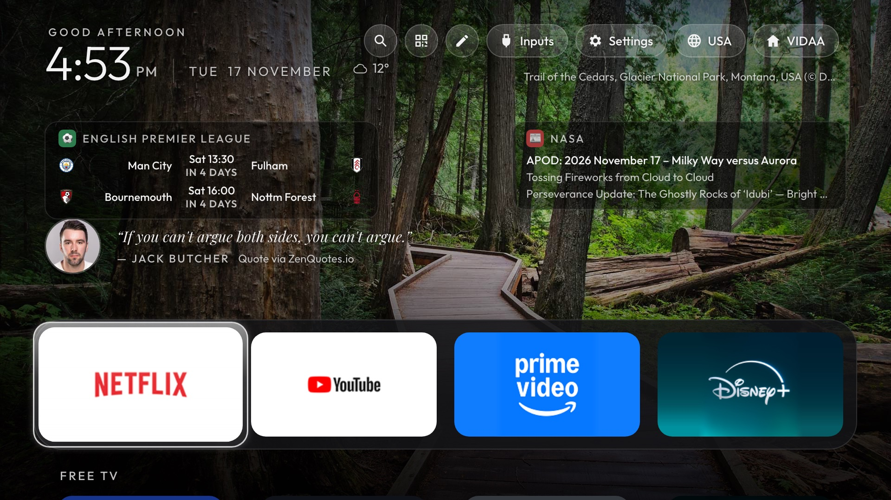
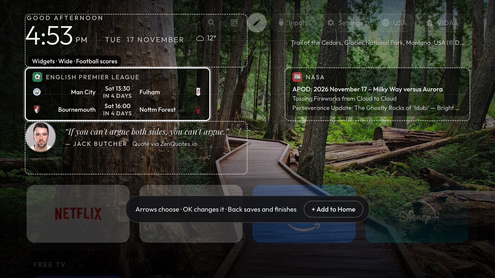
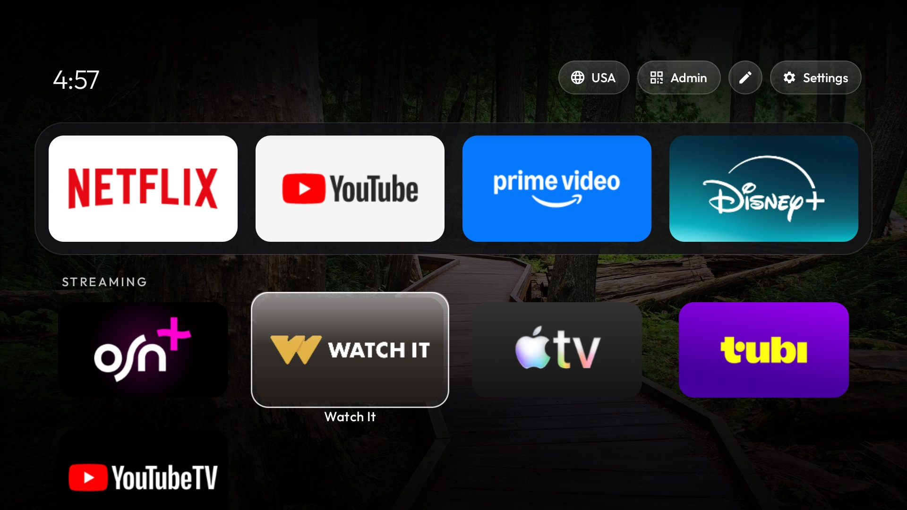
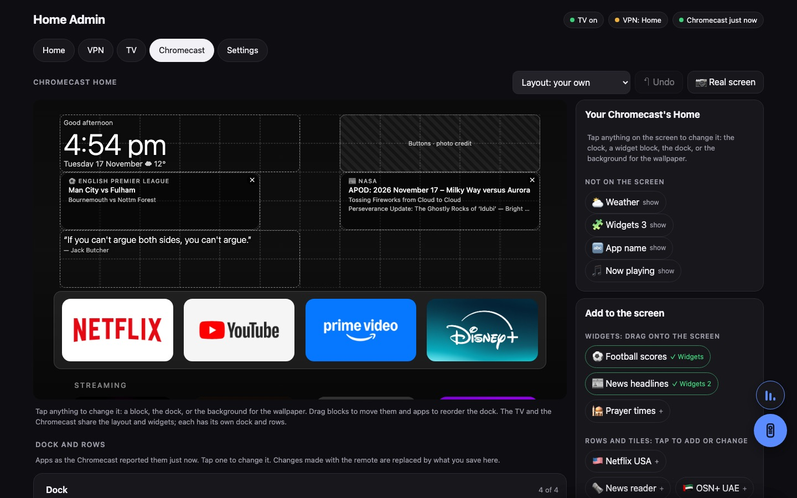
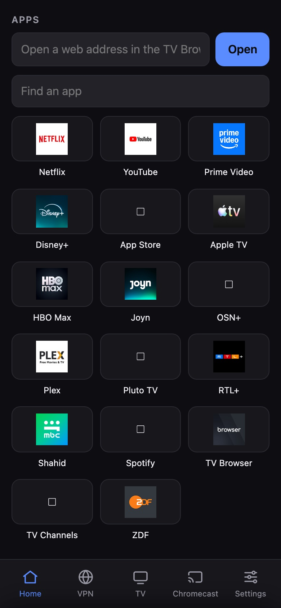
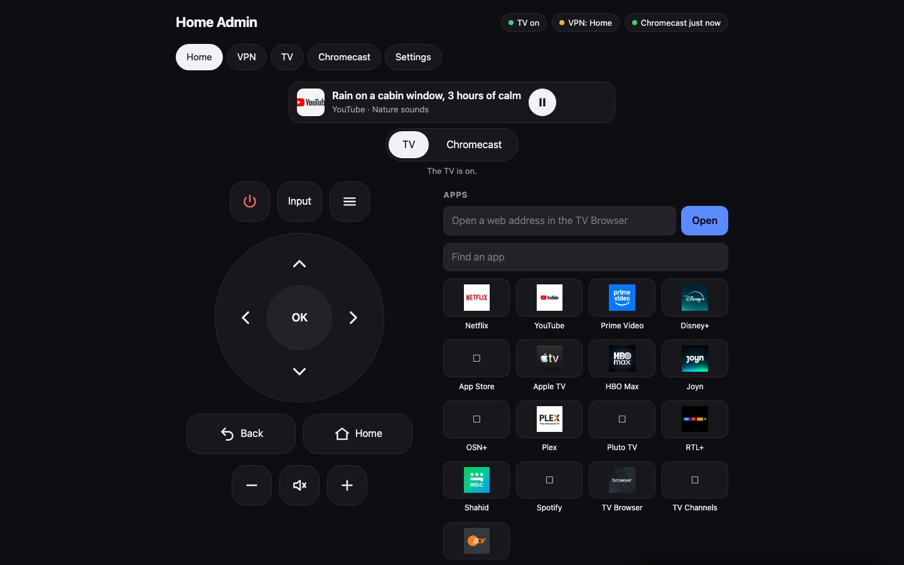
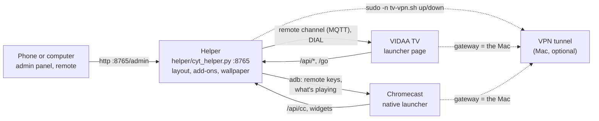
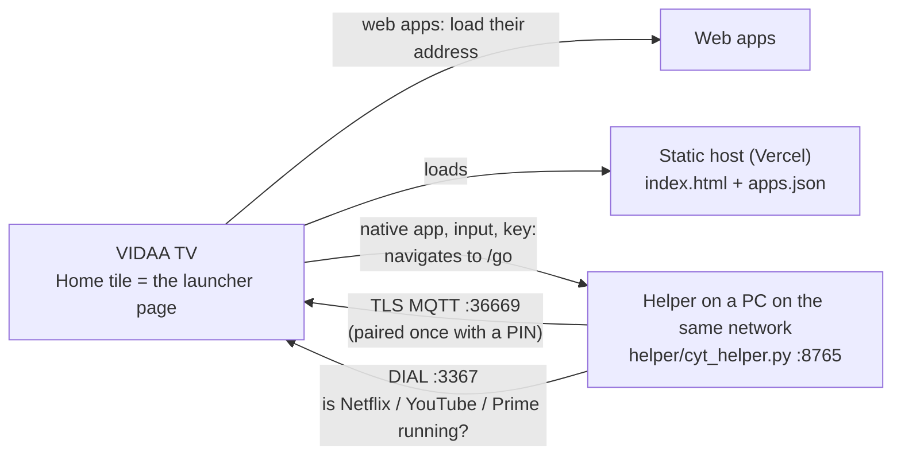

# Clean Your TV for VIDAA and Chromecast

A calm, ad-free Home screen for **Hisense VIDAA** TVs and the **Chromecast with Google TV**, run by one small helper
on a computer at home. Your apps, a clock, the weather, live football scores, a daily photo, and nothing you didn't
ask for. Change any of it from your phone, or with the TV remote.

<p align="center">
  
  
</p>

It started as a port of [CleanYourTV](https://github.com/Gathin23/cleanyourtv) to a TV that does not run Android. A
VIDAA TV is Linux, with no ADB and no way to replace its home screen, so this uses only what the TV offers: its web
runtime, its remote-control channel and its casting service. Nothing is installed on the TV except one launcher tile,
nothing is rooted or flashed, and you undo it by deleting the tile. The Chromecast gets a real launcher app.

**Website:** [gilbertmsipha.github.io/cleanyourtv-vidaa](https://gilbertmsipha.github.io/cleanyourtv-vidaa/) · **Guides:** [helper](docs/setup/helper.md) · [Chromecast](docs/setup/chromecast.md) · [VPN](docs/setup/vpn.md) · [customize](docs/customize.md) · [add-ons](addons/README.md)

**Tested on** a Hisense 50A5FE (VIDAA U9, firmware V0000.09.09A.P0930, browser Chrome 111 "Odin"), October 2026, and a Hisense 55U8Q (VIDAA U9, V0000.09.60I) with a Chromecast with Google TV 4K (Android 14), November 2026. Other VIDAA TVs should behave alike; please report yours.

## What it does

### Home, on the TV and the Chromecast

- **One look on both screens:** a four-app dock (or five, six, or the whole width), titled rows of your apps, and
  above them the blocks you choose: the clock, the weather, a quote of the day, up to three widget cards, the focused
  app's name, and what's playing.
- **The clock your way:** Classic, Bold, Stacked, Tiles, Analog or Words ("ten past nine"), a different one each day
  if you like, with the temperature on its date line.
- **A new photo every day:** Bing's, Wikipedia's or NASA's picture of the day, or your own photos.
- **Widgets:** live football scores, prayer times, news headlines; rows of new YouTube videos or this week's top
  films; full-screen pages (news reader, photo slideshow). Write your own in a few lines of Python
  ([addons/README.md](addons/README.md)).
- **Edit Home with the remote:** the ✎ pill. Arrows choose a block, OK moves, resizes or hides it, Back saves.
- **On VIDAA:** native apps (Netflix, YouTube, Prime Video), Home when the TV comes on or an app closes, a
  browser with search, Stremio, YouTube without ads, free live TV ([details below](#what-you-get-on-vidaa-and-what-you-dont)).
- **On the Chromecast:** a native Google TV launcher (`android/`): your apps only, no ads or "recommended" rows,
  hold OK to move or remove an app. It keeps working when the helper is off.

<p align="center">
  
  
</p>

### The admin panel: change everything from a browser

Open `http://<helper ip>:8765/admin` on a computer or phone at home. Each device's tab shows a picture of its Home:
tap the clock, a card, the dock or the background to change it, drag blocks and apps around, pick a preset (Classic,
Dashboard, Calm, Photo frame…), undo. A save shows on the screens within about 3 seconds. ([customize.md](docs/customize.md))

<p align="center">
  
</p>

### Your phone is the remote

The panel opens on **Home**: a remote for the TV or the Chromecast, every app to open (or a web address), and
what's playing with play/pause. Add it to your phone's Home screen and it opens full screen like an app. QR codes
on the TV's Home open it without typing.

<p align="center">
  
  
  
</p>

On a computer the remote and the apps sit side by side:

<p align="center">
  
</p>

### VPN for the TV and the Chromecast only (optional)

Watch another country's catalogue on the TV and the Chromecast while the rest of your home stays on your normal
connection. Switch the country from the TV's Region button, the panel or your phone, or give an app its own country
(OSN+ → UAE) and it switches by itself. On a Mac, `vpn/macos/tv-vpn.sh` does it with NordVPN or any WireGuard file,
your own server included; otherwise use your router. ([vpn.md](docs/setup/vpn.md))

### The original VIDAA launcher screens

<p align="center">
  
  
  
</p>

## Pick your setup

One helper on a computer at home serves both screens; use one or both.

| You have | You get | Start here |
|---|---|---|
| **A VIDAA TV** | The launcher, native apps, Home takeover, Browser, Stremio, YouTube without ads, Live TV | [Set up](#set-up) (this page), then [docs/setup/helper.md](docs/setup/helper.md) |
| **A Chromecast with Google TV** (or another Google TV / Android TV box) | A native launcher with the same look: your apps only, widgets, no ads on Home | [docs/setup/helper.md](docs/setup/helper.md) with `"vidaa": false`, then [docs/setup/chromecast.md](docs/setup/chromecast.md) |
| **Both** | Both, with one shared layout, one admin panel and one phone remote | [Set up](#set-up), then [docs/setup/chromecast.md](docs/setup/chromecast.md) |

| And for a VPN | |
|---|---|
| None | Nothing to do: the VPN parts stay hidden |
| The helper runs on a **Mac** | `vpn/macos/tv-vpn.sh`: only the TV and the Chromecast go through the VPN, switched from the TV, the panel or your phone. NordVPN or any WireGuard file, your own server included. [docs/setup/vpn.md](docs/setup/vpn.md) |
| **Windows or Linux**, or you'd rather not touch the computer | Your router's VPN with per-device rules, a Linux gateway, or a VPN app on the Chromecast. [docs/setup/vpn.md](docs/setup/vpn.md) |

## What you need

| | VIDAA TV | Chromecast | VPN (Mac) |
|---|---|---|---|
| A computer that stays on at home (Mac, Windows, Linux or a Raspberry Pi) with **Python 3.10+** | ✓ | ✓ | ✓ (a Mac) |
| [Sidee](https://github.com/Empi9245/Sidee), to pair with the TV once (PIN on screen) | ✓ | | |
| **adb** (Android platform-tools), with Wireless debugging on the Chromecast | | ✓ | |
| To build the launcher: **JDK 17+** and the Android SDK's `build-tools;35.0.0` and `platforms;android-34` (Android Studio has them) | | ✓ | |
| [Homebrew](https://brew.sh) with `wireguard-tools` and `wireguard-go` | | | ✓ |
| A VPN with WireGuard (NordVPN, Mullvad, Proton VPN, Surfshark…) or your own WireGuard server | | | ✓ |
| A fixed address for each device, with the Mac as its gateway | | | ✓ |

Optional: **ffmpeg** and **Node.js** (YouTube without ads, Stremio's streaming server), [AdGuard Home](https://adguard.com/adguard-home/overview.html)
(blocks the TV's ads; can send the devices' DNS through the VPN), a static host such as Vercel (the VIDAA launcher
keeps working with the computer off).

A cloud server can't be the helper: the TV only takes commands from its own network. Check your TV is VIDAA, not
Android TV: if ports 5555/8008/8009 are closed, 36669 and 38400 are open, and `http://<tv ip>:7000/info` says
`Linux`, it is VIDAA. If it is Android, use [CleanYourTV](https://github.com/Gathin23/cleanyourtv) instead.

## Quick start

1. **Get the code and a config:** `git clone https://github.com/WahdanZ/cleanyourtv-vidaa.git`, then
   `cp config.example.json config.json`. Chromecast only: set `"vidaa": false`.
2. **VIDAA:** pair with Sidee ([step 1 below](#1-pair-with-the-tv-once)) and add the Home tile ([step 4](#4-add-the-home-tile-to-the-tv)).
3. **Run the helper as a service:** `bash setup/macos/install.sh` (or the [Windows/Linux ones](docs/setup/helper.md#3-run-it-as-a-service)),
   then set the admin password: `.venv/bin/python helper/set_admin_password.py`.
4. **Chromecast:** put its address in `config.json`, then `android/cc.sh pair`, `android/build.sh install`,
   `android/cc.sh home` ([guide](docs/setup/chromecast.md)).
5. **Make it yours:** open `http://<helper ip>:8765/admin` and add it to your phone's Home screen.
6. **VPN (optional):** `sudo vpn/macos/tv-vpn.sh install <TV ip> <Chromecast ip>` ([guide](docs/setup/vpn.md)).

## How it works



The helper is the only server: it keeps the settings (`config.json`), runs the add-ons, fetches the photo and the
weather, and both screens ask it every few seconds whether anything changed. The admin panel saves through it; the
screens redraw within about 3 seconds.

### Limits and what's not done

- The Home button on a VIDAA remote still opens VIDAA's own home; ours comes back when the TV is turned on or
  Netflix, YouTube or Prime Video closes (VIDAA has no way to replace its home).
- The helper's computer must stay on and awake; with the VPN, the TV and the Chromecast have no internet without it.
- The Chromecast's Wireless debugging (for the remote, Now playing and the "Real screen" photo) turns off after its
  Wi-Fi changes or it restarts: `android/cc.sh connect`.
- On Android phones the panel opens with an address bar (installing as a full-screen app needs https); iPhones are fine.
- Not yet tested on hardware: some TV remote keys from the panel (media keys), the Linux VPN recipe.
- More in [docs/OPEN-PROBLEMS.md](docs/OPEN-PROBLEMS.md).

## What you get on VIDAA, and what you don't

| | Works | How |
|---|---|---|
| The CleanYourTV look | Yes | A web page drawn at 1920×1080 with the original launcher's sizes, colours, font (Outfit), glow and spring motion |
| Open web apps (Disney+, Stremio, Spotify, Plex, DStv, Apple TV…) | Yes, always | The page loads the app's own address |
| Open native apps (Netflix, YouTube 4K, Prime Video, Live TV) | With the helper | A small program on a PC on your network launches them over the TV's remote-control channel |
| Inputs menu, Settings button | With the helper | The TV's own input list; Settings sends the remote's Menu key |
| Remove apps from Home (hold OK) | Yes | Hidden from the launcher; the app stays installed |
| Home appears when the TV is switched on, and when Netflix, YouTube or Prime Video closes | With the helper | The helper watches the TV and opens the launcher (VIDAA's home flashes for ~2 s first) |
| Stremio with your addons, torrents and transcoding | With the helper | The helper serves [Stremio for VIDAA](https://github.com/NoobyGains/stremio-vidaa-tv) itself and keeps Stremio's streaming server running ([below](#stremio)) |
| YouTube without ads, up to 4K | With the helper | A **YouTube** tile of the launcher's own: the helper gets the video with [yt-dlp](https://github.com/yt-dlp/yt-dlp) (ads are separate videos, so they never come) and joins picture and sound with ffmpeg, no re-encoding. Skips sponsor segments ([SponsorBlock](https://sponsor.ajay.app/)) ([below](#youtube-without-ads)) |
| Free live TV channels | With the helper | A **Live TV** tile with the free, public channels of [iptv-org](https://github.com/iptv-org/iptv) (the lists VLC opens): your countries first, then English channels by category, zapped with Up/Down ([below](#live-tv)) |
| A browser: search with Brave, open websites | With the helper | The Search pill (or the Browser tile) types with the remote, shows suggestions as you type, then opens the page in the TV Browser ([below](#browser)) |
| Go back to VIDAA's own home | With the helper | **VIDAA** pill: *Switch to VIDAA Home* turns the automatic Home off; the same pill turns it back on |
| Replace VIDAA's home outright | **No** | VIDAA has no setting for it; the Home button still goes to VIDAA's home |
| Disable or uninstall the TV's own apps, telemetry or ads | **No** | No ADB on VIDAA. Uninstall apps on the TV itself; see [open problems](docs/OPEN-PROBLEMS.md) for ads and tracking |

### How the VIDAA part works



- **The launcher** (`web/index.html`) is one self-contained page. The TV opens it as a launcher tile.
- **Without the helper** it runs from a static host such as Vercel, reads `apps.json` (your app list with precomputed colours) and opens web apps by loading their address. That keeps working when your PC is off.
- **With the helper** the Home tile's address carries `?helper=http://<pc ip>:8765`. For native apps, inputs and keys, the page *navigates* to the helper's `/go`: an https page may not call a LAN http address, but it may navigate to one. The helper does the action over the TV's remote-control channel (MQTT on port 36669, the same channel Hisense's phone app uses) and sends the browser back.
- **Home takeover:** the helper notices the TV coming on (its port 36669 answers again) and native apps closing (DIAL reports their state), then opens the launcher, served by the helper itself with the live app list.

Why it is built this way, and every dead end on the way, is in [docs/FINDINGS.md](docs/FINDINGS.md).

## Set up

### 1. Pair with the TV (once)

Pairing uses [Sidee](https://github.com/Empi9245/Sidee) (MIT), which implements VIDAA's PIN pairing and the remote-control client. It ships the client certificate that Hisense's own remote app uses; this repo does not redistribute it. Put Sidee next to this repo:

```
your-folder/
  sidee/               git clone https://github.com/Empi9245/Sidee.git sidee
  cleanyourtv-vidaa/   this repo
```

```bash
cd sidee
python -m pip install "paho-mqtt==2.1.0"
python sidee.py          # opens a dashboard: Find TV → Request code → type the PIN shown on the TV
```

Pair only; you don't need Sidee's preset tiles. The pairing is saved in `~/.sidee/session.json`. Treat that file like a password: it lets anything on your network control the TV.

### 2. Configure and start the helper

```bash
cd cleanyourtv-vidaa
cp config.example.json config.json      # set tv_name to the TV's network name
python helper/cyt_helper.py
```

On first run Windows asks whether to allow Python on the network: allow it, or the TV can't reach the helper. Open `http://localhost:8765/` in a browser: you should see the launcher with your TV's apps. `python tools/tile.py list` prints the app ids for the config:

| Config key | What it is |
|---|---|
| `dock` / `helper_dock` | The four dock apps (app ids) when the helper serves the page, and on the hosted page with a helper |
| `static_dock` | The dock on the hosted page without a helper (web apps only) |
| `native_apps` | Native apps to show when a helper can open them (Netflix `1`, Prime Video `2`, …) |
| `web_urls` / `prefer_native_with_helper` | A web version to use without the helper (YouTube → `youtube.com/tv`), and to skip when the helper is there |
| `hidden` | Apps never shown (e.g. `166`, the E-Manual) |
| `stremio` | The Stremio tile's app id, where its web app comes from, and whether the helper runs the streaming server ([below](#stremio)) |
| `browser` | Optional: the search address (`%s` is the search), the Quick links, and `region`, the [DuckDuckGo region code](https://duckduckgo.com/duckduckgo-help-pages/settings/params/) for suggestions (`za-en` South Africa, `uk-en`, `us-en`). Brave Search, five links and no region when left out |
| `launcher_url`, `launcher_origins`, `tile_icon` | Where you host the page (step 3) |

### 3. Host the page

```bash
python tools/export_static.py    # writes web/apps.json (needs the helper running)
```

Publish `web/index.html`, `web/apps.json` and `web/tile.jpg` to any static host (Vercel, Netlify, GitHub Pages). On Vercel, a `vercel.json` with `Cache-Control: no-cache` makes the TV pick up changes immediately. Put the address in `config.json` (`launcher_url`, `launcher_origins`, `tile_icon`) and restart the helper. Re-run the export after you install or uninstall apps on the TV.

### 4. Add the Home tile to the TV

```bash
python tools/tile.py add cythome "Home" \
  "https://YOUR-PROJECT.vercel.app/?helper=http%3A%2F%2F192.168.1.50%3A8765" \
  "https://YOUR-PROJECT.vercel.app/tile.jpg"
```

Use your helper computer's address in place of `192.168.1.50`. Leave out `?helper=…` for a launcher with web apps only. On the TV, move the Home tile to the first spot of VIDAA's app row, so Home → OK always gets you there.

A tile can't be changed once added (adding the same id again is ignored), so get the address right, or add a new id and delete the old tile on the TV. To remove everything, delete the tile on the TV.

### 5. Keep the helper running

- **Windows, on a spare PC:** unpack the kit from `setup/pack.py` and run `powershell -ExecutionPolicy Bypass -File cyt-vidaa\setup\windows\setup-kit.ps1`. It installs Python, yt-dlp, Node.js and ffmpeg, moves the pairing into place, opens the firewall ports, turns off sleep (lid included) and adds the logon task. If the PC's name is the same as your account's, rename the PC first: Windows then can't tell them apart.
- **Windows, this PC:** `powershell -ExecutionPolicy Bypass -File setup\windows\install.ps1` adds a logon task that runs it hidden and restarts it if it stops. Make sure the PC doesn't sleep.
- **macOS:** `bash setup/macos/install.sh` adds a login agent that starts the helper, restarts it if it stops and keeps the Mac awake while it runs. Keep the Mac on power.
- **Linux (systemd):** `bash setup/linux/install.sh` installs a user service that starts at boot, opens port 8765 in ufw and disables sleep, including on lid close. To move a working setup to another computer, `python setup/pack.py` makes a zip with the code, Sidee's core and the pairing. Keep that zip private.

### Browser

Brave and other browsers can't be installed on VIDAA, so the launcher has a search screen of its own that hands its results to the **TV Browser**, the browser VIDAA ships with.

**How to use it**

1. On Home, press **Up** to reach the header and pick the round **🔍** button, or open the **Browser** tile in the grid (it replaces the TV Browser's tile).
2. Type with the on-screen keyboard: arrows move, **OK** types. **Space**, **Delete**, **Clear** and **.com** are on the bottom rows. A USB keyboard, or a phone remote app's typing, types too.
3. Suggestions appear on the right as you type; with the field empty, your **Recent** searches are there instead. Press **Right** past the end of a keyboard row to reach them, **OK** to search one.
4. Press **Search**. Words open Brave Search's results; an address (`bbc.com`, `https://…`, a router's `192.168.1.1`) opens as it is.
5. **Quick links** sit below the keyboard (press **Down** past the last row).
6. The page opens in the TV Browser, where the remote moves a **pointer**: arrows move it, OK clicks, Back goes back a page.
7. To come back, press **Home** and open the **Home** tile. **Back** on the search screen closes it.

**Why it works this way**

- A page opened as an app (as the launcher is) gets only arrow-key focus, which can't click around an ordinary website. The TV Browser has a pointer, and the TV opens it at any address the helper sends (`/api/browse`, `/go?browse=`), so the launcher does the typing and the TV Browser does the browsing. That needs the helper; without one the search screen isn't shown.
- Brave Search shows few ads and doesn't profile you, which is the difference from the TV Browser's own search. The websites you then open still show their own ads: the TV Browser can't take an ad blocker, and blocking ads for the whole TV (DNS) was left out on purpose ([docs/OPEN-PROBLEMS.md](docs/OPEN-PROBLEMS.md)).
- Suggestions come from DuckDuckGo's suggestion feed (Brave's turns scripts away), through the helper (`/api/suggest`) or, on the hosted page, `hosting/api/suggest.js`, a small Vercel function: the page may not ask the feed itself (no CORS).

**Settings** (`browser` in `config.json`, all optional):

```json
"browser": {
  "search": "https://search.brave.com/search?q=%s",
  "region": "za-en",
  "links": [{"name": "Brave Search", "url": "https://search.brave.com/"}, {"name": "News24", "url": "https://www.news24.com/"}]
}
```

`search` is any search address with `%s` for the words (DuckDuckGo: `https://duckduckgo.com/?q=%s`). `region` is a [DuckDuckGo region code](https://duckduckgo.com/duckduckgo-help-pages/settings/params/) for suggestions (`za-en`, `uk-en`, `us-en`). `links` replaces the Quick links; five fit on screen. Restart the helper, and re-run `tools/export_static.py` and republish for the hosted page. Recent searches are kept in the TV browser's storage, separately for the hosted and the helper-served page.

### Stremio

The TV's Stremio is the community build [Stremio for VIDAA](https://github.com/NoobyGains/stremio-vidaa-tv); add its tile with Sidee's Stremio preset (app id `stremiodebug`). On its own it can't stream torrents or transcode: that needs Stremio's streaming server on a computer, and two things keep the TV's Stremio from using one:

- The app is served over https, and a page served over https may not call a plain-http address on the home network (mixed content).
- Stremio's server answers only pages from Stremio's own sites unless it is started with `NO_CORS=1`.

So when the `stremio` setting is present, the helper does both jobs:
- **Serves the app itself** at `http://<pc ip>:8765/stremio/`. It fetches the app from its site and keeps a copy, so updates arrive and it still opens when the internet is down.
- **Keeps the streaming server running** on port 11470 with `NO_CORS=1`. It uses Stremio desktop's own server if Stremio desktop is installed; otherwise Node.js runs a copy it downloads, which needs `node` and `ffmpeg`.

The Stremio tile opens the helper's copy, already pointed at the server. Sign in once with the QR code on the TV; your account brings your addons. Without the helper, the tile opens the app's own site, where only debrid and direct streams play.

Stremio desktop on the same computer keeps working: opened after the helper, it uses the helper's server. If Stremio desktop was opened first, its own server holds the port and keeps the TV out; close Stremio desktop, and the helper starts its server within 30 seconds.

### YouTube without ads

The **YouTube** tile (`cyt-yt`) is a screen the helper serves. Put it in your dock in place of the YouTube app with `"dock": ["1", "cyt-yt", …]`; the app stays in the grid, renamed with `"rename": {"3": "YouTube app"}`.

- **Browse:** rows of videos (Continue watching, your channels, a few searches), and **Search** with the on-screen keyboard.
- **Watch:** **OK** pauses, **Left/Right** skip 10 s (hold to go faster), **Down** with the bar showing steps the quality down for slow Wi-Fi, **Back** returns. It resumes where you stopped and plays something related at the end.
- **4K:** YouTube has 4K only in VP9 and AV1, not H.264. The screen asks the TV's browser which it decodes at 2160p, prefers VP9 (hardware-decoded on TV chips; AV1 may be software), and falls back to 1080p H.264 if playback fails. What the TV reported is in the helper's log (`YouTube page: decoders`).
- **How:** the helper asks [yt-dlp](https://github.com/yt-dlp/yt-dlp) for the video and audio streams and ffmpeg copies them into one fragmented MP4 (`/yt/stream`), so the laptop's CPU barely works; seeking restarts the stream at the new time. yt-dlp is updated nightly, since YouTube changes often.
- **Settings** (`youtube` in `config.json`): `max_height` (default 2160), `channels` (`[{"name": "…", "id": "UC…"}]`, shown as rows from their RSS feeds), `home_searches`.
- No sign-in: subscriptions and history stay on the TV, not in a Google account.

### Live TV

The **Live TV** tile (`cyt-tv`) plays the free channels collected by [iptv-org](https://github.com/iptv-org/iptv): publicly available streams, the same M3U lists VLC opens.

- It starts on the last channel you watched. **Up/Down** change channel, **OK** shows what's on, **Back** opens the guide; in the guide **hold OK** to add a channel to Favourites, and **Back** from the categories leaves.
- Rows: the countries in `livetv.countries` (default Zimbabwe and South Africa), then channels in `livetv.languages` (default `eng`) by category.
- Streams are HLS. The screen tries, smoothest first: the TV's own HLS player if it has one; [hls.js](https://github.com/video-dev/hls.js) fetching directly, for channel servers that allow other sites; hls.js through the helper's `/proxy`. It remembers what worked for each channel.
- Through `/proxy` the helper keeps connections to channel servers open and fetches the newest segments ahead, so the TV's requests are answered from memory; the player keeps a ~30 s cushion a few segments behind live. That is what removed the 1-2 s pauses.
- Many free channels are off air at any moment: the helper checks every channel daily and moves those that don't answer to the end of their list, dimmed.

### Arranging tiles

Hold **OK** on a tile and choose **Move**: the tile lifts, the arrows carry it (the first four places are the dock), **OK** puts it down and **Back** cancels. **Reset the order** in the same menu goes back to `dock` in `config.json`. The order is kept by the helper (`data/order.json`); the hosted page keeps a copy and gets the helper's on every trip through `/go`, so both show the same.

## Using it

| Remote | On a tile | In the dock |
|---|---|---|
| Arrows | Move the glass highlight; Down slides the grid up | Up reaches Search / Inputs / Wi-Fi / Settings / VIDAA (with the helper) |
| OK | Open the app | |
| Hold OK | Menu: **Remove from Home**, **Restore removed apps** | |
| 🔍 Search | | The search screen ([Browser](#browser)) |
| VIDAA pill | | Switch back to VIDAA's own home (automatic Home off), or turn automatic Home back on. The choice is kept by the helper (`data/takeover.json`) |
| Back | Back to the dock | Stays on Home |

Removed apps are stored by the helper (`data/hidden.json`), or in the TV browser's storage on the hosted page without a helper. The remote's own Netflix/YouTube/Prime buttons work as always.

## Troubleshooting

| Symptom | Cause and fix |
|---|---|
| Native tiles show an error page | The helper isn't running or the PC is asleep. Press Back; web apps still work. |
| The helper stops being reached after a router restart | Your PC got a new address. The helper notices on start and adds a new Home tile; delete the old one. Reserving the PC's address on the router (DHCP reservation) avoids it. |
| The TV got a new address | The helper rediscovers it by `tv_name` over SSDP and updates the pairing. |
| Stremio says the streaming server is unavailable, or can't transcode | Check `data/helper.log`: Stremio desktop may have started its own server first (close it), or Node.js/ffmpeg are missing. The server's own output is in `data/stremio-server.log`. |
| Stremio has none of your addons | Sign in with the QR code: addons come with your Stremio account. The helper's copy keeps its own sign-in, separate from the app's own site. |
| Search opens a black screen that returns to Home | The TV Browser didn't open: check `data/helper.log` for `/go failed`. The helper must be running; searching needs it. |
| No suggestions while typing | The helper (or, on the hosted page, the Vercel function) can't reach DuckDuckGo. Searching still works. |
| A website can't be clicked | It opened in the launcher instead of the TV Browser, which happens only without a helper. Open it from the search screen with the helper running. |
| `the TV refused the connection` | The pairing was revoked (e.g. after a factory reset): pair again with Sidee. |
| The admin panel says there is no password | Run `python helper/set_admin_password.py` on the helper's computer. |
| Chromecast, VPN or admin panel problems | See the guides: [Chromecast](docs/setup/chromecast.md#troubleshooting), [VPN](docs/setup/vpn.md#checking-it), [helper](docs/setup/helper.md). |
| Holding OK opens the app instead of the menu | Your remote may not repeat or release keys like ours; open an issue with what `web/probes/probe.html` records. |

The probe pages in `web/probes/` are how everything here was found. Open one on the TV with `python tools/tile.py launch cytprobe "Probe" "http://<pc ip>:8765/probes/probe.html"`; their reports land in `reports/`.

## The website

`docs/index.html` is the project's page: a before/after slider, the screens, how it works and the challenges, in the launcher's style. GitHub Pages serves it once the repository is public: **Settings → Pages → Deploy from a branch → `main`, `/docs`**. It then lives at `https://<user>.github.io/cleanyourtv-vidaa/`.

- **Before/after:** add a photo of VIDAA's own home as `docs/screens/before.jpg` (16:9, ideally 1920×1080) and the slider appears. Without it the page shows the new home alone.
- **Buy Me a Coffee and X:** fill in `coffee` and `x` in the `LINKS` block at the bottom of `docs/index.html`. Left empty, their buttons stay hidden.
- **Link previews** on X and elsewhere use `docs/screens/social.jpg` (1200×630).
- New screenshots come from the helper-served launcher in headless Chromium at 1920×1080 with demo searches; they show no addresses or accounts.

## Contributing

Read [docs/GUIDELINES.md](docs/GUIDELINES.md) first, and [docs/CHALLENGES.md](docs/CHALLENGES.md) for what was tried and why things are the way they are. The most useful contributions are tests on other VIDAA models and firmware, and progress on the [open problems](docs/OPEN-PROBLEMS.md): blocking ads and tracking safely, detecting when web apps close, and replacing VIDAA's home outright. Please never post your TV's serial number, MAC address, IP, pairing file or Wi-Fi name in issues or screenshots.

## Credits

- [CleanYourTV](https://github.com/Gathin23/cleanyourtv) by Gathin (MIT): the idea, and the launcher design and values this page reproduces
- [Sidee](https://github.com/Empi9245/Sidee) by Empi9245 (MIT): VIDAA pairing and the remote-control client this helper uses
- [vidaa-launcher](https://github.com/Zfinix/vidaa-launcher) by Zfinix (MIT): the idea of a watcher that reopens the launcher
- [yt-dlp](https://github.com/yt-dlp/yt-dlp) (Unlicense) and [FFmpeg](https://ffmpeg.org/) (LGPL/GPL): YouTube streams, run as separate programs
- [SponsorBlock](https://sponsor.ajay.app/) (data CC BY-NC-SA 4.0): sponsor segments to skip
- [iptv-org/iptv](https://github.com/iptv-org/iptv) (Unlicense): the free channel lists
- [hls.js](https://github.com/video-dev/hls.js) (Apache-2.0, `web/vendor/hls.min.js`): HLS playback
- [Outfit](https://github.com/Outfitio/Outfit-Fonts) font (SIL Open Font License, `web/fonts/OFL.txt`)
- [WireGuard](https://www.wireguard.com/) (`wireguard-go`, `wireguard-tools`): the VPN tunnel, installed separately
- Data for Home: [Open-Meteo](https://open-meteo.com/) (weather), [ZenQuotes](https://zenquotes.io/) (quotes), Bing, Wikimedia Commons and NASA APOD (wallpapers), ESPN (football), [AlAdhan](https://aladhan.com/) (prayer times), Apple's RSS charts (top movies)

## License

MIT, see [LICENSE](LICENSE). Not affiliated with Hisense, VIDAA, Google or any VPN provider; their names and app logos belong to their owners. Use it on TVs you own.
