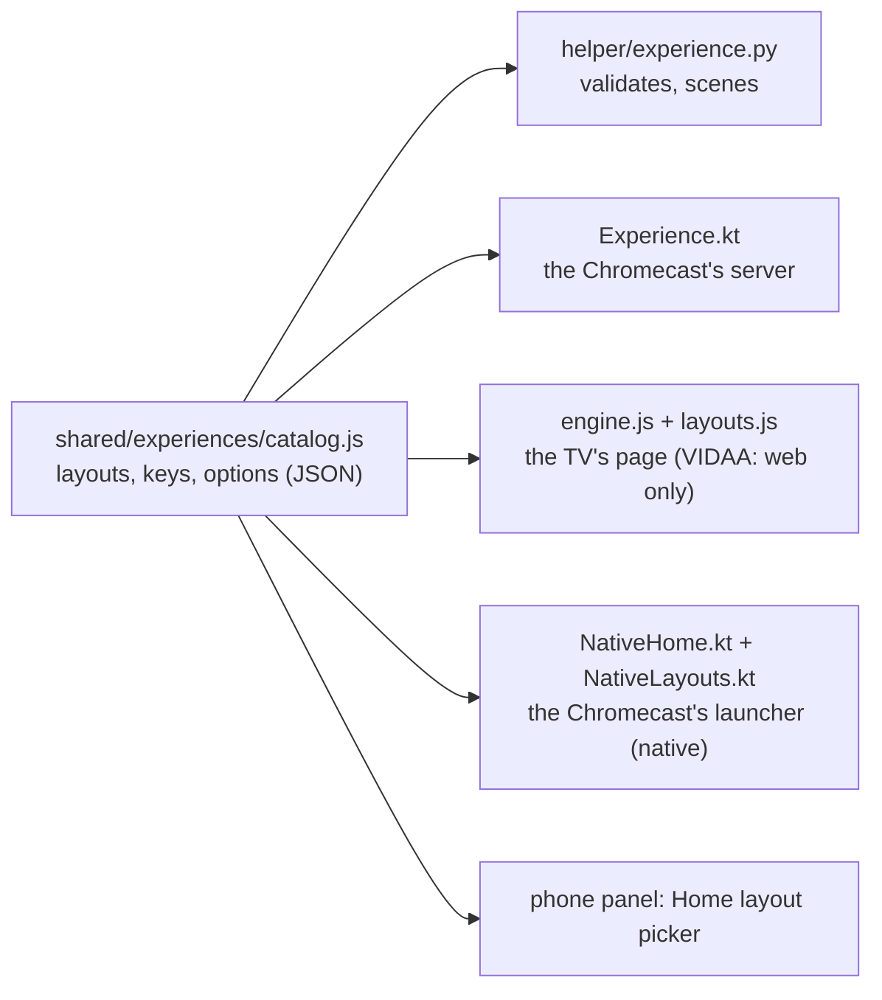

# Home layouts

Fourteen ways for Home to look and move, on the VIDAA TV and on the Chromecast, plus **Classic** (the Home there
was before, still the default). They all show the same things: your favourite apps and every other app, the TV's
inputs and Live TV, widgets, scenes, what is playing and today's photo. Only the arrangement and what the remote's
keys do change. Switching between them loses nothing.

**Choose one:** phone panel → **TV** or **Chromecast** tab → **Home layout**. Pick a layout; its keys and options show
below it; **Save**. The screen changes within seconds. The TV and the Chromecast each have their own choice.

The ten concepts and four follow-ups come from the research atlas *CleanYourTV_10_TV_UI_Layout_Concepts.pdf*
(v1.0, 20 Nov 2026), called "the atlas" below, with its page numbers.

## The layouts

On the TV: previews drawn by the TV's engine with made-up data. On the Chromecast: the native launcher on Google
TV's emulator, with its apps.

| # | Layout | The idea | Remote | TV | Chromecast |
|---|---|---|---|---|---|
| 01 | **Liquid OS** | Favourites as bubbles; the focused one grows, the others make room, always in the same order | ◀ ▶ favourites · ▲ sources · ▼ all apps | [TV](../shared/experiences/previews/liquid.jpg) | [CC](screens/layouts/cc-liquid.jpg) |
| 02 | **Channel Zero** | A numbered dial of Live TV, inputs and apps; number keys jump to a channel | ▲ ▼ surf (wraps) · ▶ details · ◀ favourites | [TV](../shared/experiences/previews/channel.jpg) | [CC](screens/layouts/cc-channel.jpg) |
| 03 | **Typography First** | Huge verbs: WATCH, PLAY, LISTEN, SOURCES; the apps inside by name | ▲ ▼ verb · ▶ enter · ◀ back to verbs | [TV](../shared/experiences/previews/typography.jpg) | [CC](screens/layouts/cc-typography.jpg) |
| 04 | **Floating Worlds** | Four islands; OK enters one; favourites one key away | ◀ ▶ world · ▲ TV controls · ▼ favourites | [TV](../shared/experiences/previews/worlds.jpg) | [CC](screens/layouts/cc-worlds.jpg) |
| 05 | **The Fold** | Four slanted panels; the focused one unfolds its short list | ◀ ▶ panel · OK list · ▲ shortcuts · ▼ all apps | [TV](../shared/experiences/previews/fold.jpg) | [CC](screens/layouts/cc-fold.jpg) |
| 06 | **Four Directions** | One key, one place: ▲ discover, ▶ sources, ▼ all apps, ◀ resume; OK the one used last | at the hub only; 1-4 favourites | [TV](../shared/experiences/previews/four.jpg) | [CC](screens/layouts/cc-four.jpg) |
| 07 | **The Time River** | Resume, Now, what's next (a match, a prayer time), your scenes, in time order | ◀ ▶ moments · OK says what it does | [TV](../shared/experiences/previews/river.jpg) | [CC](screens/layouts/cc-river.jpg) |
| 08 | **The Gallery** | Four to six framed places, today's photo among them | ◀ ▶ frame · ▲ about it · ▼ the whole collection | [TV](../shared/experiences/previews/gallery.jpg) | [CC](screens/layouts/cc-gallery.jpg) |
| 09 | **Aurora** | A quiet clock and still light; any arrow shows a short strip of places | first key only shows · Back hides | [TV](../shared/experiences/previews/aurora.jpg) | [CC](screens/layouts/cc-aurora.jpg) |
| 10 | **The Command Deck** | The selected place large, the TV's real state beside it (input, playback, VPN), favourites below | ◀ ▶ favourites · ▲ controls | [TV](../shared/experiences/previews/deck.jpg) | [CC](screens/layouts/cc-deck.jpg) |
| T | **Theater** | Today's photo, a headline, what's playing, one row of places. The atlas's recommended default | ◀ ▶ · ▲ now playing · ▼ all apps | [TV](../shared/experiences/previews/theater.jpg) | [CC](screens/layouts/cc-theater.jpg) |
| S | **Signal** | Channel Zero's dial grouped under headings, with the photo on the stage; a variant, not a copy | ◀ next group | [TV](../shared/experiences/previews/signal.jpg) | [CC](screens/layouts/cc-signal.jpg) |
| C | **Scene Stage** | Your scenes as large cards; OK starts one. Only scenes you allow on Home | ◀ ▶ scenes · ▼ favourites | [TV](../shared/experiences/previews/scenes.jpg) | [CC](screens/layouts/cc-scenes.jpg) |
| A | **Ambient** | Aurora over today's photo with the clock centred; a variant of Aurora | as Aurora | [TV](../shared/experiences/previews/ambient.jpg) | [CC](screens/layouts/cc-ambient.jpg) |

In every layout: **hold OK** (or Menu) for the menu: All apps, Sources, the phone panel's QR code, **Classic Home**
(until Home restarts), Settings. **Back** always goes up one level and never leaves Home. The key hints are on screen.

**Options** (in the panel, per layout): the bubbles' count, the dial's order, the headline, which apps are Watch,
Play and Listen, the app a match opens, the frames and strip size, the scenes allowed on Home, and **Motion**
(gentle or none).

**App icons fit their shape.** Each icon is redrawn for the tile it's in, from the app's own artwork. An app with an
adaptive icon (most Android apps) has it drawn into the shape, the way Android does. A TV app that only has a
banner (Netflix, YouTube TV…) has its background colour read from the banner's edges and its logo cut out. The
whole circle or frame is then filled with that colour, with the logo set inside as large as fits. A wide tile
keeps the banner edge to edge. No rectangle pasted on a colour, and no logo redrawn by hand (they belong to their
owners). An **icon theme** restyles them all: phone panel → Home layout → App icons (Glass, Monochrome, Light
tiles, or your own: [making an icon theme](../addons/README.md#icon-themes)). A theme puts each app's colour and logo on the theme's
plate (round, rounded or square), on the theme's background, grey if it says so. Themes apply to the layouts here,
not to Classic.

## How it is built

- **One catalog** (`shared/experiences/catalog.js`) lists every layout, what its six keys do and its options. The
  screens draw from it, the panel shows it, and both servers check saved choices against it.
- **Two renderers, one design.** A VIDAA TV can only show a web page, so the TV draws them with `engine.js` and
  `layouts.js`. The Chromecast draws them natively in Kotlin (`NativeHome.kt`, `NativeLayouts.kt`): no web view.
  Both have the same parts:
  - **Items:** one shape for an app, an input, Live TV, a scene, the player and the photo (atlas p.29, "a verified
    source-action abstraction").
  - **act():** opens one and says the honest result.
  - **Shared screens:** All apps, Sources, the menu and the photo.
  - **Focus:** kept per layout and restored by item id.
  - **States:** loading, empty, offline and reduced motion.

  `tests/experiences_test.py` fails if a layout in the catalog is missing from either renderer.
- **Classic is untouched** and stays underneath on both. It is the fallback:
  - if the TV's files fail to load;
  - if a Chromecast layout throws (it falls back to Classic, logs why, and Home itself never crashes);
  - from the menu, or when Classic is chosen in the panel.
- **Saved** as `config.json` → `home_experience: {tv, cc, opts, scenes}`. Unknown options are dropped, an unknown
  layout is refused, and a layout removed later shows as Classic ([shared/API.md](../shared/API.md)).

## What each setup can do

The atlas p.26 ("No magic APIs") is the rule: a control appears only where the device can really do it.

| | Chromecast only | Chromecast + VIDAA | VIDAA only |
|---|---|---|---|
| All 14 layouts | ✓ native | ✓ on both screens | ✓ on the TV |
| Opening apps | ✓ | ✓ | ✓ through the helper |
| TV inputs (HDMI), Live TV source | no TV to switch: Sources says why | ✓ (the Chromecast asks the helper) | ✓ |
| Now playing | ✓ the media session | ✓ | the Chromecast's, when there is one |
| Scenes on Home | ✓ allowed ones | ✓ | ✓ |
| VPN in the Command Deck | ✓ when its key is set | ✓ | ✓ |
| Volume, brightness, Wi-Fi | not shown: no verified API (atlas p.24) | | |

## How the research shaped it

Each section separates **research** (what the atlas says, with the sources it lists on p.31: the project's README,
customize guide, challenges and open problems, TV design guidance, and Apple's Human Interface Guidelines for
remote-driven screens) from **design choices made here**, and **untested assumptions**. The atlas itself says its
assessments are "an expert hypothesis, not a research result" (p.28), and that no performance or preference claim
has been validated (p.30). Nothing below has been tested with people yet.

### Navigation

- **Research:**
  - Each concept's D-pad focus map (p.6, 8, 10, 12, 14, 16, 18, 20, 22, 24) is implemented key for key. For
    example, Four Directions is UP discover, RIGHT sources, DOWN all apps, LEFT resume, OK last used.
  - "A deterministic focus map; no mouse gestures or mystery movement" (p.4).
  - "Directional shortcuts only apply at the hub level" (p.16).
  - "Back after returning restores WATCH" (p.14).
- **Design choices:**
  - Back never leaves Home; it goes up one level, then to the first place.
  - Hold OK (or Menu) opens the same menu in every layout.
  - Channel Zero's dial wraps around like a TV's, and number keys jump to a channel (they focus it, and don't open it).
  - Four Directions' 1-4 keys open the favourites shown in the corner. That is the "visible favourites dock for
    beginners" from p.16.
- **Untested:** whether muscle memory forms in five minutes (p.16), and how often Signal's grouping helps.

### Focus indicators

- **Research:**
  - "One clear selection state" (p.4).
  - "A single visible focus ring" (p.27).
  - The focus colour is #79D6E9 (p.27).
  - "A visible focus outline remains independent of the fold animation" (p.14).
- **Design choices:**
  - One ring: 5 px of the focus colour plus a dark halo, so it shows on any app colour and on photos. Tiles also
    grow 6%.
  - A selected item that doesn't have focus (Channel Zero's row while its buttons have focus) gets a fainter outline.
  - The Gallery uses the warm colour and Scene Stage white, to suit their palettes.
  - The automated tests check that exactly one focus is visible after every key, in every layout.
- **Untested:** whether the ring reads well at three metres on a 55" TV.

### Typography and readability

- **Research:**
  - "Large headings, 24-32 px labels, and safe horizontal edges" (p.27).
  - "Make fonts robust to … very long translated labels" (p.10).
  - "Never remove text labels in pursuit of visual purity" (p.20).
- **Design choices:**
  - The stage is 1920 × 1080, scaled to the screen. Labels are never under 24 px, and the side margins are 96 px.
  - Every label is one line with an ellipsis.
  - Every tile and frame has its name written under it, Liquid's bubbles included.
- **Untested:** readability on the Hisense 55U8Q at sofa distance (the atlas's test environment, p.30).

### Content hierarchy

- **Research:**
  - Fast access to favourites, Live TV and inputs (p.2).
  - "Give sources and HDMI the same importance as apps" (p.32).
  - "Honest data: no invented universal watch history, source previews or device controls" (p.4).
  - "If little data exists, collapse gracefully to favourites" (p.18).
- **Design choices:**
  - **Resume** means "opened from this Home", kept on the device. It is never a guess at an app's own history.
  - The Time River fills up with favourites when there are fewer than three real moments.
  - A match opens the app you chose; with none chosen, the screen says so instead of inventing a stream (p.18).
  - Channel Zero's stage says "OK switches the TV to it" and never shows a fake preview (p.8).
- **Untested:** whether people use the timeline or fall back to favourites (p.18).

### Motion and performance

- **Research:**
  - "120-180 ms subtle motion. Offer reduced motion" (p.27).
  - "Use CSS transforms; no continuous physics, heavy blur or WebGL" (p.6).
  - "2D transforms … rather than 3D CSS tricks" (p.14).
  - "Avoid constant GPU effects, shimmer" (p.22).
  - "Hold focus steady during refresh" (p.27).
- **Design choices:**
  - 160 ms on transform and opacity only.
  - Aurora's light is still: no animation loop.
  - The Fold's panels are drawn 2D (a skewed shape natively, `skewY` on the TV).
  - New data redraws in place with focus kept by item id.
  - Reduced motion has three sources: the layout option, the system setting (`prefers-reduced-motion` on the TV,
    "remove animations" on Android), or both.
  - The Chromecast pauses its clock and player polling while another app is in front.
- **Untested:** frame rates on the VIDAA browser and on the Chromecast's own hardware. They were measured on
  neither; only the emulator and desktop Chrome were used.

### Accessibility

- **Research:**
  - Reduced motion (p.27).
  - High-contrast focus (p.10).
  - Labels (p.20).
- **Design choices:**
  - The menu is always one long press away.
  - The key hints are written on every screen.
  - Aurora and Ambient keep a faint hint visible, because discoverability is their main risk (p.28).
  - Their first key press only reveals, and never opens anything (p.22).
  - Colour is never the only signal: badges say APP, HDMI, LIVE.
- **Untested:** use with TalkBack (the native views carry their text, but this was not checked) and colour-blind
  contrast.

### TV-specific interactions

- **Research:**
  - The VIDAA Home key can't be replaced, and the helper is needed for native apps and inputs (p.2, p.26).
  - "Show a clear helper-offline state before attempting source switching" (p.8).
  - "Do not open privileged admin actions from an unauthenticated TV page" (p.24).
  - Scenes on TV need "a new scoped endpoint" (p.26).
- **Design choices:**
  - **Scenes:** `/api/home-scene-run` runs only the scenes allowed on Home in the panel, and the screens get only
    the scene names and their steps in words, never the raw steps.
  - **Offline:** the screen shows a red "Server offline" badge, and actions report their real result.
  - **Inputs:** switching an input without the helper explains why instead of failing silently.
  - **The phone's trackpad:** a tap over a native layout is OK on whatever has focus.
- **Untested:** remote key quirks of other VIDAA models (the TV page reuses the existing key handling, including
  the OK-hold detection for remotes that send no key-up).

### Platform-specific decisions

- **Research:**
  - The capability matrix on p.26.
  - "Unsupported actions disappear" (p.24).
  - "Do not clone the backend; reuse both platform contracts" (p.29).
- **Design choices:**
  - **Renderers:** the TV uses web technology because VIDAA allows nothing else. The Chromecast is native Kotlin,
    at the project owner's request: no web view, full use of the launcher's own icons, media session and VPN
    switch.
  - **No duplication of what matters:** both use the same catalog, endpoints, validation rules and tests.
  - **Live TV on the Chromecast** is an installed app whose name says so (YouTube TV, Live Channels…). This is a
    design choice, not detection.
  - **Default Watch, Play and Listen groups** come from a fixed list of well-known names, never from usage. The
    panel can set each list.
- **Untested:** the Chromecast-only setup with no helper at all, on a real device.

## What was tested, and what wasn't

| Tested | How |
|---|---|
| The TV engine: all 14 layouts draw, take all six keys with exactly one focus, open things, restore focus after a reload, handle empty data, offline, reduced motion, number keys, inputs without the helper, adaptive icons and icon themes (190 checks) | `tests/experiences_test.py` (headless Chrome; also in CI) |
| The catalog, both renderers implementing every layout, validation, scene scoping, icon themes | `tests/experiences_test.py` |
| Both servers: the choice round-trips, a bad one is refused, scenes are scoped, the catalog is served | `tests/api_contract.py`: the helper 40/40, the Chromecast's server 39/39 (on the emulator) |
| The TV page against a real (test) helper with 53 real app entries: the layout loads, switches live after a save, opens an app through the helper | desktop Chrome at 1920 × 1080 |
| Icons designed for their shape, natively: adaptive icons in circles; banner-only test apps (dark, white, gradient banners) as filled circles and frames; the Monochrome theme | Google TV emulator; three code-free test apps with TV banners (your apps are 32-bit and can't install there) |
| The native Chromecast layouts: all 14 chosen through the server, a sequence of arrows, OK, Back and Home in each: no crash, no fallback; screenshots | Google TV emulator (arm64) |
| The panel's picker: choose, save, the screen follows | the emulator's panel in a phone-sized browser |
| The real Chromecast: the new app installs; its server serves the catalog and the TV's inputs through the helper | adb |

**Not tested:** the layouts on the real Chromecast's screen and on the VIDAA TV's browser (the Chromecast was asleep,
and waking it turns the TV on); speed on either device; use with people (the atlas's plan on p.30). On the
emulator a change from the panel took up to about 20 seconds to show (the Classic Home's usual check is every
3 seconds; the emulator is slow); the real device wasn't timed.
